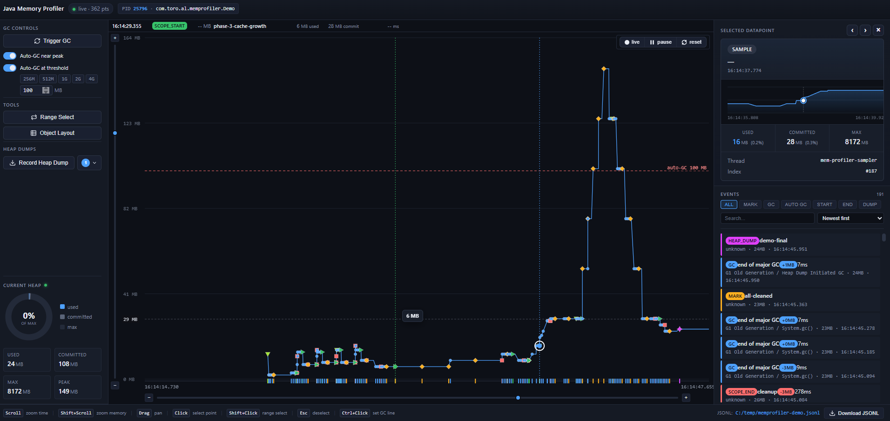
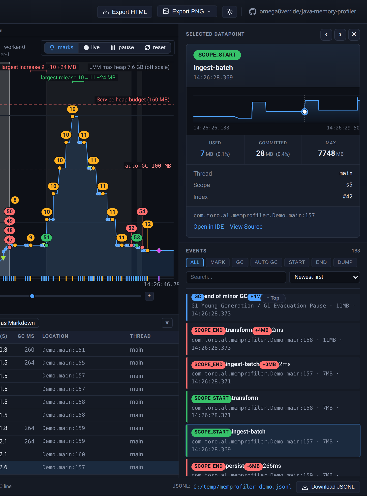

# Java Memory Profiler

A lightweight, in-process heap profiler for Java apps. Unlike external profilers,
this tool is designed to be **driven from your code** — you decide exactly where
to trigger GC, drop markers, measure scopes, and capture heap dumps, giving you
precise, repeatable measurements at the points that matter.

> **Disclaimer:** This is a vibe-coded project — but highly functional and reliable.



> **📂 [See the full Demo](src/main/java/com/toro/al/memprofiler/Demo.java)** — a comprehensive working example that exercises every feature.
>
> ```
> java -cp java-memory-profiler-1.0.0.jar com.toro.al.memprofiler.Demo
> ```

- **Continuous sampling** — a daemon thread records heap usage every N ms.
- **GC notifications** — every JVM garbage collection is captured as a `GC` event (name, cause, pause duration, bytes reclaimed) via `GarbageCollectorMXBean` notifications, so nothing is missed between samples.
- **Code markers** — call `MemoryProfiler.mark("label")` at any point to run a GC and drop a labeled marker into the timeline.
- **Scopes** — wrap a block in `MemoryProfiler.scope("label")` to record `SCOPE_START` / `SCOPE_END` with the heap delta and wall-clock duration.
- **`@Profile` annotation** — annotate interface methods and wrap the impl in `ProfiledProxy` to get scope markers without touching the method body.
- **Heap dumps** — record `.hprof` heap dumps from code (`MemoryProfiler.heapDump("name")`) or from the web UI with one click. Configure an opener to launch dumps in VisualVM, IntelliJ, or the OS default handler.
- **Java agent** — attach with `-javaagent:...` to start the profiler before `main()` runs, zero code changes.
- **Live web UI** — real-time line chart, marker overlays, event list, click-to-open source.
- **JSONL output** — every data point is appended to an optional `.jsonl` file for post-mortem analysis.

## API overview

The entire public surface lives on `MemoryProfiler`. You never need to reach
for a second class.

```java
// Lifecycle
MemoryProfiler.start();                        // defaults
MemoryProfiler.start(config);                  // prebuilt Config
MemoryProfiler.start(c -> c.intervalMs(250));  // inline Config via lambda
MemoryProfiler.stop();                         // stop sampling; UI stays up
MemoryProfiler.await();                        // block until JVM exits (keeps UI alive)
MemoryProfiler.shutdown();                     // full teardown: stop everything + close
MemoryProfiler.isRunning();                    // boolean
MemoryProfiler.get();                          // running instance, or null

// Point-in-time marks
MemoryProfiler.mark("label");                  // cheap    — no GC
MemoryProfiler.markGc("label");                // precise  — runs System.gc() first

// Scoped measurements (implement AutoCloseable)
try (Scope s = MemoryProfiler.scope("label"))   { ... }  // cheap
try (Scope s = MemoryProfiler.scopeGc("label")) { ... }  // GC at entry + exit → precise delta

// Annotation-driven scopes (interfaces only)
Iface wrapped = MemoryProfiler.wrap(Iface.class, impl);

// Heap dumps
MemoryProfiler.heapDump("after-load");             // records .hprof with given name
MemoryProfiler.heapDump();                          // auto-generated name
```

Every method is safe to call before `start()` or after `stop()`/`shutdown()` — marks/scopes
become no-ops instead of throwing.

### Lifecycle: `stop` vs `shutdown` vs `await`

| Method       | Sampling | GC listener | Web UI | Data store |
|--------------|----------|-------------|--------|------------|
| `stop()`     | Stopped  | Stopped     | **Running** | Flushed |
| `shutdown()` | Stopped  | Stopped     | Stopped | Closed  |

`stop()` ends profiling but keeps the web server alive so you can still browse
the collected data. Call `await()` after `stop()` to block the calling thread
and prevent the JVM from exiting:

```java
MemoryProfiler.stop();    // profiling ends, data flushed
MemoryProfiler.await();   // blocks here — UI stays up until Ctrl-C
```

`shutdown()` tears everything down and releases all resources. This is what the
Java agent's shutdown hook calls.

### Configuration

`Config` is a fluent builder. Keys match the agent args (next section) 1:1, so
you only learn one vocabulary.

```java
MemoryProfiler.start(MemoryProfiler.Config.defaults()
    .intervalMs(250)                 // sampler tick (default 500)
    .maxPoints(50_000)               // ring-buffer capacity (default 20_000)
    .port(9090)                      // fixed UI port (default: pick a free one)
    .jsonl("C:/tmp/heap.jsonl")      // append every data point to disk
    .openBrowser(false)              // default true
    .startServer(true)               // default true; set false for headless
    .gcListener(true)                // default true; set false to skip GC notifications
    .autoGcNearPeak(true)            // auto-GC when heap nears observed peak (default false)
    .autoGcThreshold(true, 1024)     // auto-GC when heap exceeds threshold in MB (default false)
    .sourceRoots("src/main/java",    // resolve class locations to files for "Open in IDE"
                 "src/test/java")
    .forceGc(3, 80));                // System.gc() loop used by markGc/scopeGc
```

#### Heap dump configuration

```java
MemoryProfiler.start(c -> c
    .heapDumpDir("C:/tmp/dumps")               // where .hprof files are saved (default: java.io.tmpdir)
    .heapDumpOpener("visualvm",                // "system", "visualvm", or "intellij"
        "C:/libs/visualvm_221/bin/visualvm.exe") // optional path to the opener binary
);
```

The opener controls what happens when you click a dump in the UI or call
`heapDumper.open(path)`:

| Opener      | Behaviour                                                                |
|-------------|--------------------------------------------------------------------------|
| `system`    | Uses `Desktop.open()` — opens with whatever the OS associates with `.hprof`. |
| `visualvm`  | Launches VisualVM with `--openfile`. Auto-detects `jvisualvm` on PATH or in `JAVA_HOME`, or use the explicit binary path. |
| `intellij`  | Launches IntelliJ IDEA with the file path. Works best when `.hprof` is associated with IntelliJ internally. Alternatively, use `system` and set IntelliJ as the default handler for `.hprof` files in Windows. |

The lambda form is usually shorter:

```java
MemoryProfiler.start(c -> c.intervalMs(100).jsonl("heap.jsonl"));
```

### Marks — `mark` vs `markGc`

A mark records a single labeled data point with the current heap reading.

| Call                 | Runs `System.gc()`? | When to use                                              |
|----------------------|---------------------|----------------------------------------------------------|
| `mark("label")`      | No                  | Tag events in hot paths: per-request, per-iteration, etc. Cheap. |
| `markGc("label")`    | Yes (configurable)  | Checkpoints where you want a *retained-memory* reading (before/after a load). |

```java
MemoryProfiler.markGc("before load");
loadConfig();
MemoryProfiler.markGc("after load");    // delta between the two = real retained growth

for (Request r : stream) {
  MemoryProfiler.mark("req " + r.id);   // cheap — tagging only
  handle(r);
}
```

### Scopes — `scope` vs `scopeGc`

A scope pairs a `SCOPE_START` with a `SCOPE_END`, and the end carries the
heap delta and wall-clock duration.

| Call                  | Runs `System.gc()`? | When to use                                          |
|-----------------------|---------------------|------------------------------------------------------|
| `scope("label")`      | No                  | Always-on instrumentation, tight loops. Delta reflects raw allocation/retention at the moment of exit. |
| `scopeGc("label")`    | Yes, at entry and at exit | Debugging leaks or sizing components. Delta reflects what the scope *retained*, not allocation churn. |

```java
try (var s = MemoryProfiler.scope("handle-request")) {
  handleRequest(req);
}

try (var s = MemoryProfiler.scopeGc("load-index")) {   // forces GC at start + end
  loadBigIndex();
}
```

### Annotations — `@Profile` + `wrap`

`@Profile` marks an interface method as a scope. Wrap the impl with
`MemoryProfiler.wrap(...)` so each call gets a scope automatically.

```java
public interface ImportJob {
  @Profile("parse-feed")                    // → scope("parse-feed")
  void parse();

  @Profile(value = "write-db", gc = true)   // → scopeGc("write-db")
  void write();

  void housekeeping();                      // no annotation → passes through, not profiled
}

ImportJob job = MemoryProfiler.wrap(ImportJob.class, new ImportJobImpl());
job.parse();   // SCOPE_START + SCOPE_END with delta + duration
job.write();   // ditto, plus System.gc() at both ends
```

Limitations:

- **Interfaces only.** `java.lang.reflect.Proxy` can't proxy concrete classes.
  For a class with no interface, call `scope`/`scopeGc` directly in the method body.
- **The wrap call is required.** The annotation is just metadata; without
  `wrap` nothing intercepts the invocation.

### Java agent (no code changes)

```
java -javaagent:java-memory-profiler-1.0.0.jar=intervalMs=250,jsonl=C:/tmp/heap.jsonl,port=9090,openBrowser=false ^
     -cp your-app.jar com.example.Main
```

Agent args are comma-separated `key=value` pairs. **Keys match `Config`
method names 1:1.**

| Key            | Default | Meaning                                                    |
|----------------|---------|------------------------------------------------------------|
| `intervalMs`   | `500`   | Background sampler interval (ms).                          |
| `maxPoints`    | `20000` | In-memory ring-buffer capacity.                            |
| `port`         | auto    | Fixed port for the live UI.                                |
| `jsonl`        | none    | Append all data points to this `.jsonl` file.              |
| `openBrowser`  | `true`  | Open the default browser at startup.                       |
| `startServer`  | `true`  | Run the embedded HTTP server.                              |
| `gcListener`   | `true`  | Subscribe to `GarbageCollectorMXBean` notifications.       |
| `autoGcNearPeak` | `false` | Trigger `System.gc()` when heap nears the observed peak. |
| `autoGcThreshold` | `false` | Trigger `System.gc()` when heap exceeds a fixed MB threshold. |
| `autoGcThresholdMB` | —   | Threshold in MB for `autoGcThreshold`.                     |
| `sourceRoots`  | none    | Comma-separated source roots for "Open in IDE" resolution. |
| `heapDumpDir`  | tmpdir  | Directory where `.hprof` heap dumps are saved.             |
| `heapDumpOpener` | `system` | How to open dumps: `system`, `visualvm`, or `intellij`.  |
| `heapDumpOpenerPath` | auto | Path to the opener binary (VisualVM / IntelliJ).       |

A shutdown hook calls `shutdown()` to flush the JSONL file and stop the server on JVM exit. When
attached, you can still call `MemoryProfiler.mark/scope/...` from code — the
agent just bootstraps the singleton early.

## Live web UI

Opens at the URL printed on startup (`http://localhost:<port>/`).


- The line chart shows the used-heap timeline, updated every 500 ms.
- Markers (amber), scope starts (green), scope ends (red), and GC events
  (blue) appear as vertical lines on the chart and as entries in the
  right-hand event list.
- **Follow** keeps the chart scrolling with live data; uncheck it to freeze
  the view window while you inspect.
- **mark** drops an ad-hoc marker from the browser. Useful when you want to
  tag an external event (a request you just sent, a UI action).
- **GC** triggers `System.gc()` remotely.
- **download jsonl** streams the JSONL file back to the browser.
- Click any point or event to see its full details (timestamp, thread,
  location, delta, duration). The **open in IDE** link asks the JVM's
  desktop handler to open the source file. The link only works when you
  configure source roots so the profiler can map a class location like
  `com.example.Import.parse:88` to a real file:

  

  ```java
  MemoryProfiler.start(c -> c.sourceRoots(
      "src/main/java",
      "src/test/java"));
  ```
- **Range select** — Shift+Click two points on the chart (or toggle the
  Range Select tool in the left panel) to analyze a range: memory delta,
  min/max/avg used, duration, and event counts within the window.

  

- **Heap dumps** — click "Record Heap Dump" in the left panel to capture an
  `.hprof` file immediately. A badge shows the count of recorded dumps;
  click it to open a dropdown listing all dumps. Click any dump to open it
  in the configured tool (VisualVM, IntelliJ, or the OS default).

  

## Object layout analyzer

The web UI includes an object layout tool that shows the exact memory layout of
any Java class — object header, fields (with JVM offsets), and padding bytes.
Access it at `http://localhost:<port>/layout.html`.


There are two ways to analyze a class:

### 1. Paste source code

Paste a class definition (or just field declarations) directly into the UI.
The profiler compiles the code in-memory and analyzes the resulting class.
No agent required.

```java
// You can paste a full class:
public class Order {
  long id;
  boolean active;
  String customer;
  int quantity;
  double total;
}

// Or just field declarations (auto-wrapped in a class):
long id;
boolean active;
String customer;
```

### 2. Browse loaded classes (agent mode)

When running as a Java agent, the profiler has access to
`Instrumentation.getAllLoadedClasses()` and can list every class the JVM has
loaded. The UI provides a searchable class list — pick any class to see its
layout instantly.

This requires either:

- **Java agent** — attach with `-javaagent:java-memory-profiler-1.0.0.jar=...`
  (instrumentation is available automatically).
- **Self-attach via VM option** — if not using the agent, add
  `-Djdk.attach.allowAttachSelf=true` to your VM options so the profiler can
  obtain instrumentation at runtime without the `-javaagent` flag.

If neither is available, the class browser returns an error and only the
paste-source-code mode works.

### Layout output

For each class the analyzer reports:

| Region   | Description                                              |
|----------|----------------------------------------------------------|
| Header   | Object header (typically 12 bytes with compressed oops)  |
| Field    | Instance field with offset, size, type, declaring class  |
| Padding  | Alignment gaps inserted by the JVM                       |

Summary: shallow size, header size, total field size, total padding.

## Data model

Each data point is one JSON object:

```json
{"index":42,"timestamp":1713878400000,"usedMB":312,"committedMB":512,"maxMB":2048,
 "kind":"SCOPE_END","label":"parse-feed","location":"com.example.Import.parse:88",
 "sourceFile":"com/example/Import.java:88",
 "scopeId":"s7","deltaMB":18,"durationMs":412,"thread":"worker-1"}
```

`kind` is one of:

| Kind          | Source                                    | Notes                                                                     |
|---------------|-------------------------------------------|---------------------------------------------------------------------------|
| `SAMPLE`      | background sampler (every `interval` ms)  | heap used/committed/max at the sample instant                             |
| `MARK`        | `MemoryProfiler.mark(...)` / `markGc(...)` / UI button | `markGc` + the UI button run `System.gc()` first; plain `mark` does not  |
| `SCOPE_START` | `scope(...)` / `scopeGc(...)` entry       | baseline for the scope                                                    |
| `SCOPE_END`   | `Scope.close()`                           | fills `deltaMB` and `durationMs` relative to the matching `SCOPE_START`   |
| `GC`          | `GarbageCollectorMXBean` notification     | `label` = gcAction, `location` = `gcName / gcCause`, `deltaMB` = reclaimed, `durationMs` = pause |
| `HEAP_DUMP`   | `MemoryProfiler.heapDump(...)` / UI button | `label` = dump name, `location` = path to `.hprof` file |
| `AUTO_GC`     | `AutoGcController` (threshold or near-peak trigger) | `label` = trigger reason, `location` = `AutoGcController` |

Downstream tooling can tail the JSONL.

## Notes

- `System.gc()` is only a hint to the JVM. In practice all mainstream
  collectors honour it promptly, which is what makes before/after deltas
  meaningful — but scope delta values are still approximate.
- The embedded server binds to `localhost` only. Not intended for
  production / public exposure.
- The in-memory buffer is a fixed-size window. For long runs, enable JSONL
  output and tail the file.
