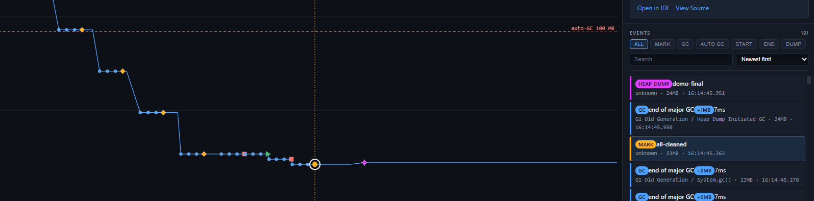
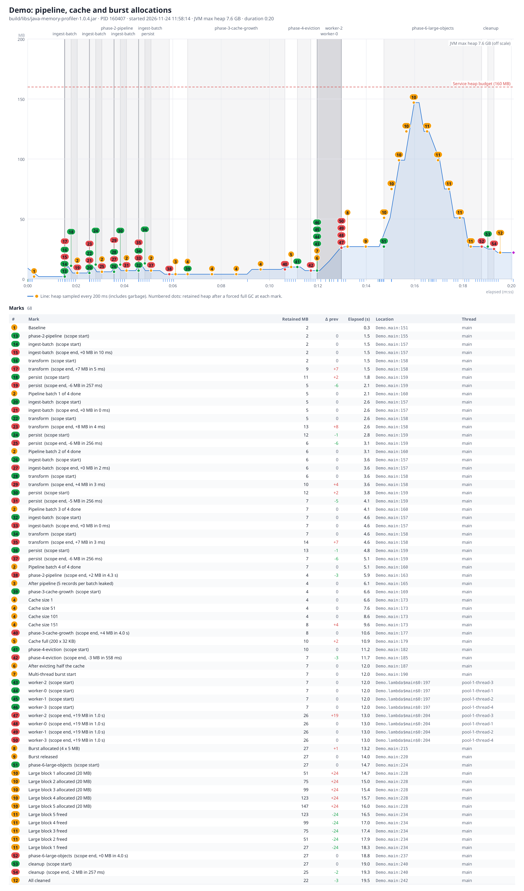
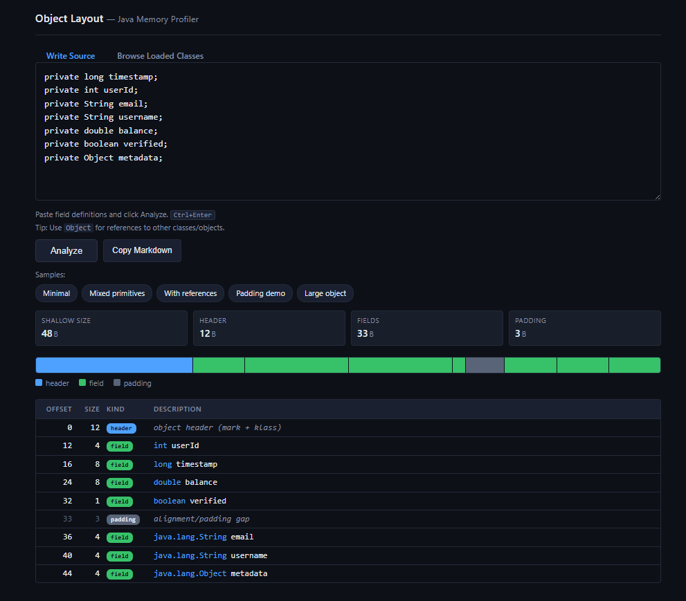

# Java Memory Profiler

A lightweight, in-process heap profiler for Java apps. Unlike external profilers,
this tool is designed to be **driven from your code** — you decide exactly where
to trigger GC, drop markers, measure scopes, and capture heap dumps, giving you
precise, repeatable measurements at the points that matter.

> **Disclaimer:** This is a vibe-coded project — but highly functional and reliable.


> **📂 [See the full Demo](src/main/java/com/toro/al/memprofiler/Demo.java)** — a comprehensive working example that exercises every feature.
>
> ```
> java -cp java-memory-profiler-1.0.0.jar com.toro.al.memprofiler.Demo
> java -jar java-memory-profiler-1.0.0.jar --export docs   # headless: writes docs/demo-profile.html and .png
> ```

- **Continuous sampling** — a daemon thread records heap usage every N ms.
- **GC notifications** — every JVM garbage collection is captured as a `GC` event (name, cause, pause duration, bytes reclaimed) via `GarbageCollectorMXBean` notifications, so nothing is missed between samples.
- **Code markers** — call `MemoryProfiler.mark("label")` at any point to run a GC and drop a labeled marker into the timeline.
- **Scopes** — wrap a block in `MemoryProfiler.scope("label")` to record `SCOPE_START` / `SCOPE_END` with the heap delta and wall-clock duration.
- **`@Profile` annotation** — annotate interface methods and wrap the impl in `ProfiledProxy` to get scope markers without touching the method body.
- **Heap dumps** — record `.hprof` heap dumps from code (`MemoryProfiler.heapDump("name")`) or from the web UI with one click. Configure an opener to launch dumps in VisualVM, IntelliJ, or the OS default handler.
- **Java agent** — attach with `-javaagent:...` to start the profiler before `main()` runs, zero code changes.
- **Live web UI** — real-time line chart, marker overlays, event list, click-to-open source.
- **JSONL output** — every data point is appended to an optional `.jsonl` file for post-mortem analysis.
- **Mark annotations** — numbered badges on marks, scope bands, reference lines and a marks table, so a chart reads without hovering.
- **Export interactive HTML** — one self-contained `.html` file of the run that opens offline (from disk, email or a Jira attachment) with zoom, hover and the marks table. [Example](docs/demo-profile.html) (download it and open it locally).
- **Export PNG** — a static image of the whole run with the annotations, for bug reports. [Example](docs/demo-profile.png).
- **Compare runs** — `export --compare` overlays a baseline and fix variants on one chart with a mark-by-mark comparison table, as a PNG and as an interactive HTML page.
- **Segments and GC pressure** — retained-heap change between marks (`--segments 2:4,5:7`), automatic "largest increase / release" callouts, shading where GC takes most of the wall time, and a GC summary.
- **Self-describing JSONL** — every run starts with a `META` line (run id, interval, title, reference lines) and every point carries the run id, so offline exports need no options.
- **Optional dependency** — the tiny `memprofiler-api` jar lets library code call `markGc` / `scope` without depending on the profiler; the calls are no-ops when it is absent.

## API overview

The entire public surface lives on `MemoryProfiler`. You never need to reach
for a second class.

```java
// Lifecycle
MemoryProfiler.start();                        // defaults
MemoryProfiler.start(config);                  // prebuilt Config
MemoryProfiler.start(c -> c.intervalMs(250));  // inline Config via lambda
MemoryProfiler.stop();                         // stop sampling; UI stays up
MemoryProfiler.await();                        // block until JVM exits (keeps UI alive)
MemoryProfiler.await(Duration.ofMinutes(2));    // keep the UI for 2 minutes, then shut down and return
MemoryProfiler.shutdown();                     // full teardown: stop everything + close
MemoryProfiler.isRunning();                    // boolean
MemoryProfiler.get();                          // running instance, or null

// Point-in-time marks
MemoryProfiler.mark("label");                  // cheap    — no GC
MemoryProfiler.markGc("label");                // precise  — runs System.gc() first
MemoryProfiler.markGc("label", 1);             // from a helper: record the helper's caller as the location

// Scoped measurements (implement AutoCloseable)
try (Scope s = MemoryProfiler.scope("label"))   { ... }  // cheap
try (Scope s = MemoryProfiler.scopeGc("label")) { ... }  // GC at entry + exit → precise delta

// Annotation-driven scopes (interfaces only)
Iface wrapped = MemoryProfiler.wrap(Iface.class, impl);

// Heap dumps
MemoryProfiler.heapDump("after-load");             // records .hprof with given name
MemoryProfiler.heapDump();                          // auto-generated name

// Chart annotations and exports
MemoryProfiler.referenceLine(5120, "Production heap limit (5 GB)"); // dashed line, also in the JSONL
MemoryProfiler.title("Cache loader: full load");    // chart title for exports (also written to the JSONL)
MemoryProfiler.subtitle("variant B: batch inserts"); // subtitle, also written to the JSONL
MemoryProfiler.exportHtml("build/profile.html");    // self-contained, interactive, offline
MemoryProfiler.exportPng("build/profile.png");      // static image of the whole run
MemoryProfiler.exportPng("build/peak.png", PngOptions.defaults().fromMark("5").toMark("8").includeTable(true));
```

Every method is safe to call before `start()` or after `stop()`/`shutdown()` — marks/scopes
become no-ops instead of throwing. The exceptions are `exportHtml` / `exportPng`, which
work while running and after `stop()`, but throw `IllegalStateException` after
`shutdown()` (use `exportHtmlOnStop` / `exportPngOnStop` to export on the way out).

### Lifecycle: `stop` vs `shutdown` vs `await`

| Method       | Sampling | GC listener | Web UI | Data store |
|--------------|----------|-------------|--------|------------|
| `stop()`     | Stopped  | Stopped     | **Running** | Flushed |
| `shutdown()` | Stopped  | Stopped     | Stopped | Closed  |

`stop()` ends profiling but keeps the web server alive so you can still browse
the collected data. Call `await()` after `stop()` to block the calling thread
and prevent the JVM from exiting:

```java
MemoryProfiler.stop();    // profiling ends, data flushed
MemoryProfiler.await();   // blocks here — UI stays up until Ctrl-C
```

`shutdown()` tears everything down and releases all resources. This is what the
Java agent's shutdown hook calls.

`await()` blocks until the JVM is killed, which is awkward at the end of a test
(the test runner keeps the build lock). Keep the UI up for a limited time instead:

```java
MemoryProfiler.stop();                          // on-stop exports are written here
MemoryProfiler.await(Duration.ofMinutes(2));    // UI for 2 minutes, then shutdown() and return

// or once, in the config (also the agent argument keepUiAfterStop=<seconds>):
MemoryProfiler.start(c -> c.keepUiAfterStop(Duration.ofMinutes(2)).exportHtmlOnStop("build/profile.html"));
MemoryProfiler.stop();     // writes the HTML snapshot, keeps the UI for 2 minutes, then shuts down
MemoryProfiler.await();    // returns when the UI closes (not never)
```

### Configuration

`Config` is a fluent builder. Keys match the agent args (next section) 1:1, so
you only learn one vocabulary.

```java
MemoryProfiler.start(MemoryProfiler.Config.defaults()
    .intervalMs(250)                 // sampler tick (default 500)
    .maxPoints(50_000)               // ring-buffer capacity (default 20_000)
    .port(9090)                      // fixed UI port (default: pick a free one)
    .jsonl("C:/tmp/heap.jsonl")      // write every data point to disk
    .jsonlMode(MemoryProfiler.JsonlMode.APPEND) // add the run to an existing file (default OVERWRITE)
    .skipCallerPrefixes("com.acme.util.ProfilerHooks") // helpers to skip for mark locations
    .keepUiAfterStop(Duration.ofMinutes(2))      // after stop(): UI for 2 minutes, then shut down
    .openBrowser(false)              // default true
    .startServer(true)               // default true; set false for headless
    .gcListener(true)                // default true; set false to skip GC notifications
    .autoGcNearPeak(true)            // auto-GC when heap nears observed peak (default false)
    .autoGcThreshold(true, 1024)     // auto-GC when heap exceeds threshold in MB (default false)
    .sourceRoots("src/main/java",    // resolve class locations to files for "Open in IDE"
                 "src/test/java")    //   and source snippets in HTML exports
    .forceGc(3, 80)                  // System.gc() loop used by markGc/scopeGc
    .title("Cache loader")           // chart title for exports and the JSONL (default: process name)
    .subtitle("variant B")           // chart subtitle
    .exportHtmlOnStop("build/profile.html")   // written on stop() and shutdown()
    .exportPngOnStop("build/profile.png")     // optional PngOptions as 2nd argument
    .exportMaxSamples(20_000)        // HTML exports: SAMPLE points kept (min/max downsampling)
    .exportSourceLines(6));          // HTML exports: lines of source around each mark
```

#### Heap dump configuration

```java
MemoryProfiler.start(c -> c
    .heapDumpDir("C:/tmp/dumps")               // where .hprof files are saved (default: java.io.tmpdir)
    .heapDumpOpener("visualvm",                // "system", "visualvm", or "intellij"
        "C:/libs/visualvm_221/bin/visualvm.exe") // optional path to the opener binary
);
```

The opener controls what happens when you click a dump in the UI or call
`heapDumper.open(path)`:

| Opener      | Behaviour                                                                |
|-------------|--------------------------------------------------------------------------|
| `system`    | Uses `Desktop.open()` — opens with whatever the OS associates with `.hprof`. |
| `visualvm`  | Launches VisualVM with `--openfile`. Auto-detects `jvisualvm` on PATH or in `JAVA_HOME`, or use the explicit binary path. |
| `intellij`  | Launches IntelliJ IDEA with the file path. Works best when `.hprof` is associated with IntelliJ internally. Alternatively, use `system` and set IntelliJ as the default handler for `.hprof` files in Windows. |

The lambda form is usually shorter:

```java
MemoryProfiler.start(c -> c.intervalMs(100).jsonl("heap.jsonl"));
```

### Marks — `mark` vs `markGc`

A mark records a single labeled data point with the current heap reading.

| Call                 | Runs `System.gc()`? | When to use                                              |
|----------------------|---------------------|----------------------------------------------------------|
| `mark("label")`      | No                  | Tag events in hot paths: per-request, per-iteration, etc. Cheap. |
| `markGc("label")`    | Yes (configurable)  | Checkpoints where you want a *retained-memory* reading (before/after a load). |

```java
MemoryProfiler.markGc("before load");
loadConfig();
MemoryProfiler.markGc("after load");    // delta between the two = real retained growth

for (Request r : stream) {
  MemoryProfiler.mark("req " + r.id);   // cheap — tagging only
  handle(r);
}
```

`markGc` records how long its forced GC took (`gcMs` in the JSONL, the **GC ms**
column of the marks table), so you can tell which gaps in the sampling the
profiler caused itself.

#### Mark locations through a helper

Each mark records the location of its caller (`Class.method:line`), skipping the
profiler's own frames, reflection and proxies. When marks go through a helper
of your own (for example a reflection bridge, so the code compiles without the
profiler jar), skip the helper too:

```java
MemoryProfiler.markGc(label, 1);                        // the helper passes 1: its caller is recorded
MemoryProfiler.start(c -> c.skipCallerPrefixes("com.acme.util.ProfilerHooks"));
// or -Dmemprofiler.skipCallers=com.acme.util.ProfilerHooks   (comma or ; separated)
// or the agent argument skipCallers=com.acme.util.ProfilerHooks
```

The [`memprofiler-api`](#instrument-a-library-without-a-hard-dependency) facade
needs none of this: its frames are always skipped.

### Scopes — `scope` vs `scopeGc`

A scope pairs a `SCOPE_START` with a `SCOPE_END`, and the end carries the
heap delta and wall-clock duration.

| Call                  | Runs `System.gc()`? | When to use                                          |
|-----------------------|---------------------|------------------------------------------------------|
| `scope("label")`      | No                  | Always-on instrumentation, tight loops. Delta reflects raw allocation/retention at the moment of exit. |
| `scopeGc("label")`    | Yes, at entry and at exit | Debugging leaks or sizing components. Delta reflects what the scope *retained*, not allocation churn. |

```java
try (var s = MemoryProfiler.scope("handle-request")) {
  handleRequest(req);
}

try (var s = MemoryProfiler.scopeGc("load-index")) {   // forces GC at start + end
  loadBigIndex();
}
```

### Annotations — `@Profile` + `wrap`

`@Profile` marks an interface method as a scope. Wrap the impl with
`MemoryProfiler.wrap(...)` so each call gets a scope automatically.

```java
public interface ImportJob {
  @Profile("parse-feed")                    // → scope("parse-feed")
  void parse();

  @Profile(value = "write-db", gc = true)   // → scopeGc("write-db")
  void write();

  void housekeeping();                      // no annotation → passes through, not profiled
}

ImportJob job = MemoryProfiler.wrap(ImportJob.class, new ImportJobImpl());
job.parse();   // SCOPE_START + SCOPE_END with delta + duration
job.write();   // ditto, plus System.gc() at both ends
```

Limitations:

- **Interfaces only.** `java.lang.reflect.Proxy` can't proxy concrete classes.
  For a class with no interface, call `scope`/`scopeGc` directly in the method body.
- **The wrap call is required.** The annotation is just metadata; without
  `wrap` nothing intercepts the invocation.

### Java agent (no code changes)

```
java -javaagent:java-memory-profiler-1.0.0.jar=intervalMs=250,jsonl=C:/tmp/heap.jsonl,port=9090,openBrowser=false ^
     -cp your-app.jar com.example.Main
```

Agent args are comma-separated `key=value` pairs. **Keys match `Config`
method names 1:1.**

| Key            | Default | Meaning                                                    |
|----------------|---------|------------------------------------------------------------|
| `intervalMs`   | `500`   | Background sampler interval (ms).                          |
| `maxPoints`    | `20000` | In-memory ring-buffer capacity.                            |
| `port`         | auto    | Fixed port for the live UI.                                |
| `jsonl`        | none    | Write all data points to this `.jsonl` file.               |
| `jsonlMode`    | `overwrite` | `append` adds the run to an existing file.             |
| `skipCallers`  | none    | Class-name prefixes skipped for mark locations, separated by `;`. |
| `keepUiAfterStop` | until killed | Seconds to keep the UI after the run, then shut down. |
| `openBrowser`  | `true`  | Open the default browser at startup.                       |
| `startServer`  | `true`  | Run the embedded HTTP server.                              |
| `gcListener`   | `true`  | Subscribe to `GarbageCollectorMXBean` notifications.       |
| `autoGcNearPeak` | `false` | Trigger `System.gc()` when heap nears the observed peak. |
| `autoGcThreshold` | `false` | Trigger `System.gc()` when heap exceeds a fixed MB threshold. |
| `autoGcThresholdMB` | —   | Threshold in MB for `autoGcThreshold`.                     |
| `sourceRoots`  | none    | Source roots separated by `;` ("Open in IDE", snippets in HTML exports). |
| `title`        | process | Chart title for exports.                                   |
| `subtitle`     | none    | Chart subtitle for exports.                                |
| `exportHtml`   | none    | Write an interactive HTML export here when the JVM exits.  |
| `exportPng`    | none    | Write a PNG of the whole run here when the JVM exits.      |
| `png.<option>` | —       | Any [PNG option](#png-options), e.g. `png.includeTable=true,png.theme=dark`. |
| `exportMaxSamples` | `20000` | SAMPLE points kept in HTML exports.                    |
| `heapDumpDir`  | tmpdir  | Directory where `.hprof` heap dumps are saved.             |
| `heapDumpOpener` | `system` | How to open dumps: `system`, `visualvm`, or `intellij`.  |
| `heapDumpOpenerPath` | auto | Path to the opener binary (VisualVM / IntelliJ).       |

```
java -javaagent:java-memory-profiler-1.0.0.jar=exportHtml=C:/tmp/profile.html,exportPng=C:/tmp/profile.png,png.includeTable=true ^
     -cp your-app.jar com.example.Main
```

A shutdown hook calls `shutdown()` to flush the JSONL file, write the
`exportHtml` / `exportPng` files and stop the server on JVM exit. When
attached, you can still call `MemoryProfiler.mark/scope/...` from code — the
agent just bootstraps the singleton early.

## Instrument a library without a hard dependency

Library or production code often must not depend on the profiler. Two ways to instrument it anyway:

**1. The `memprofiler-api` jar** (recommended). A 5 KB jar with no dependencies
(Java 8), built next to the profiler (`memprofiler-api/build/libs/memprofiler-api-<version>.jar`).
Add it as a normal dependency; it forwards every call to the profiler when the
profiler is on the runtime classpath (`-javaagent`, or the test classpath) and
does nothing otherwise. It never throws, and the recorded location is the real
caller.

```java
import com.toro.al.memprofiler.api.MemoryProfiler;   // the API, not the profiler

MemoryProfiler.markGc("5. Import: batch start (" + rows + " rows)");
try (MemoryProfiler.Scope s = MemoryProfiler.scopeGc("write batch")) {
  writeBatch();
}
MemoryProfiler.referenceLine(5120, "Production heap limit (5 GB)");
```

It offers `mark`, `markGc`, `scope`, `scopeGc`, `referenceLine`, `title`,
`heapDump`, `isAvailable()` and `isRunning()`. The profiler jar bundles the same
classes, so code compiled against the API also runs with only the profiler jar.

**2. A reflection bridge** in your own code, when you cannot add any jar:

```java
final class ProfilerHooks {
  private static final java.lang.reflect.Method MARK_GC = find();

  private static java.lang.reflect.Method find() {
    try {
      return Class.forName("com.toro.al.memprofiler.MemoryProfiler").getMethod("markGc", String.class, int.class);
    } catch (Throwable t) {
      return null; // profiler not on the classpath: no-op
    }
  }

  static void markGc(String label) {
    if (MARK_GC == null) return;
    try {
      MARK_GC.invoke(null, label, 1); // 1: record our caller, not this bridge
    } catch (Throwable ignored) {
    }
  }
}
```

## Live web UI

Opens at the URL printed on startup (`http://localhost:<port>/`).


- The line chart shows the used-heap timeline, updated every 500 ms. It is
  continuous through GC pauses: where the sampler was stalled by GC the line
  is dashed, and it only breaks where nothing was observed (see
  [the gap rule](#the-heap-line-continuous-dashed-or-broken)). Ranges where GC
  takes at least half of the wall time are shaded and labelled "GC overhead N%".
  A key under the chart gives the sampling interval and the GC totals.
- Markers (amber), scope starts (green), scope ends (red), and GC events
  (blue) appear as vertical lines on the chart and as entries in the
  right-hand event list.
- **Follow** keeps the chart scrolling with live data; uncheck it to freeze
  the view window while you inspect.
- **mark** drops an ad-hoc marker from the browser. Useful when you want to
  tag an external event (a request you just sent, a UI action).
- **GC** triggers `System.gc()` remotely.
- **download jsonl** streams the JSONL file back to the browser.
- Click any point or event to see its full details (timestamp, thread,
  location, delta, duration). The **open in IDE** link asks the JVM's
  desktop handler to open the source file. The link only works when you
  configure source roots so the profiler can map a class location like
  `com.example.Import.parse:88` to a real file:

  

  ```java
  MemoryProfiler.start(c -> c.sourceRoots(
      "src/main/java",
      "src/test/java"));
  ```
- **Range select** — Shift+Click two points on the chart (or toggle the
  Range Select tool in the left panel) to analyze a range: memory delta,
  min/max/avg used, duration, and event counts within the window.

  

- **Heap dumps** — click "Record Heap Dump" in the left panel to capture an
  `.hprof` file immediately. A badge shows the count of recorded dumps;
  click it to open a dropdown listing all dumps. Click any dump to open it
  in the configured tool (VisualVM, IntelliJ, or the OS default).

  

## Mark annotations

Marks are easier to discuss when they have numbers. The live chart (the
**marks** toggle in the chart's control bar), the HTML export and the PNG
export all draw the same annotations with the same rules:

- **Badges.** Every `MARK`, `SCOPE_START` and `SCOPE_END` is a dot at its
  `usedMB` with a numbered badge above it. A label that starts with
  `<number>. ` shows that number: `markGc("7. DB cache: all rows in one batch (peak)")`
  gets badge **7**. Numbers may repeat (several `6.` progress marks each get
  their own **6** badge). Points without a number are numbered in order,
  starting after the highest explicit number in the run, so the two never
  share a badge. (`"7.5 GB loaded"` is not numbered: the dot must be followed
  by a space.)
- **Collision avoidance.** Badges are placed in time order. A badge that
  would touch an earlier one moves up one slot at a time and gets a thin
  leader line to its dot; at the top of the plot it tries the slots below;
  if nothing is free it is hidden (the PNG key says how many). Badges never
  overlap each other or the reference-line labels, and never leave the plot.
- **Marks table.** `#`, label (without the number prefix), retained MB,
  delta to the previous row, delta to the first mark, elapsed seconds, forced-GC
  time (**GC ms**, when recorded), `Class.method:line` and thread.
  In the browser, clicking a row selects the point and centres the chart on it;
  **hide repeats** keeps only the first and the last of repeated numbers (several
  `6.` progress marks); **Copy as Markdown** puts the table on the clipboard; the
  full location is in the tooltip of the location cell.
- **Scope bands.** Each `scope()` / `scopeGc()` pair is a light, neutral band
  across the plot with its label above the plot. Titles of narrow, adjacent
  bands go on two alternating rows; a title that does not fit is shortened
  with "…" or left out. Titles never overlap.
- **Reference lines.** A dashed line for the JVM max heap (or an "off scale"
  note when it is far above the data) and one per
  `MemoryProfiler.referenceLine(mb, label)`. Reference lines are stored in the
  run's JSONL `META` line, so exports made later from the file show them. A
  reference value is never a heap reading: it is not on the heap line and not
  in the peak or any statistic.

The rules live in `Annotations.java` (PNG) and `web/annotations.js` (browser),
which mirror each other. `markGc` readings are taken after a forced full GC,
which is what the PNG key calls "retained heap"; plain `mark` readings include
garbage.

## Export interactive HTML

One self-contained `.html` file that reproduces the viewer for a finished (or
running) profile, offline: no server and no network access. Double-click it,
attach it to an email or a Jira ticket. **[Example generated from the demo](docs/demo-profile.html)**
(download it and open it locally; GitHub shows the source).

What the file contains:

- The whole run, initially zoomed to fit, with zoom (wheel), pan (drag),
  crosshair, hover card and a **reset zoom** button.
- The Summary, Events, Selected and range panels working on the embedded data.
- Mark badges, scope bands, reference lines and the marks table.
- A header with the title, process, PID, JVM max heap, start time, duration,
  profiler version and export time.
- Light and dark themes: the file follows the OS setting; the header toggle
  overrides it.
- Optional **source snippets**: when `sourceRoots` resolve a mark's source
  file, ±6 lines around the mark are embedded and shown in the hover card and
  the Selected panel.
- Live-only controls (GC, add mark, auto-GC, heap dump, open in IDE, object
  layout) are hidden or disabled with a tooltip that says the page is a snapshot.

| Entry point | Usage |
|-------------|-------|
| UI          | **Export HTML** button in the header: downloads `profile-<process>-<yyyyMMdd-HHmmss>.html` |
| HTTP        | `GET /export/html` (sent as an attachment) |
| Java        | `MemoryProfiler.exportHtml("build/profile.html")`, while running or after `stop()` |
| Config      | `.exportHtmlOnStop("build/profile.html")` writes it on `stop()` and `shutdown()` |
| Agent       | `-javaagent:java-memory-profiler.jar=exportHtml=C:/tmp/profile.html` |
| CLI (offline) | `java -jar java-memory-profiler.jar export --jsonl run.jsonl --html out.html` |

CLI options for HTML:

| Option | Default | Meaning |
|--------|---------|---------|
| `--jsonl <file>` | required | JSONL written with `Config.jsonl(...)` or the `jsonl=` agent argument |
| `--run last\|all\|<n>` | `last` | A JSONL file can hold several appended runs (see [run splitting](#runs-in-one-file)). `all` joins them (renumbered). `--list-runs` prints them with title and duration. |
| `--title <text>` / `--subtitle <text>` | recorded | Header text; default: the title recorded in the file's `META` line, else the file name |
| `--interval <ms>` | recorded | The configured sampling interval, for files from 1.0.4 and older that do not record it |
| `--segments <a:b,...>` | — | Segment brackets (see [segments](#segments-and-gc-pressure)); also printed |
| `--summary` | — | Print peak, retained, GC totals, GC share per minute and the largest increase / release |
| `--format-label-numbers` | off | Thousands separators in numbers inside labels |
| `--source-roots <a;b>` | none | Roots for embedded source snippets |
| `--source-lines <n>` | `6` | Lines of context above and below each mark |
| `--max-samples <n>` | `20000` | SAMPLE points kept |

**How it is built.** At export time each ES module reachable from
`web/app.js` is read from the jar, its relative imports (`'./state.js'`) are
rewritten to bare names (`'@memprofiler/web/state.js'`), and it is embedded
as a `data:text/javascript;base64,…` URL in an import map. Vue 3.4.38 is
vendored in the jar (`web/vendor/vue.esm-browser.prod.js`, MIT, with its
licence header and `LICENSE-vue.txt`) and mapped the same way; the CSS is
inlined. The live UI is unchanged: it still loads the separate module files
and Vue from unpkg. The profile is embedded as
`<script type="application/json" id="profile-data">` with every `<`, `>` and
`&` inside strings written as `\u003c` etc., so labels such as `</script>`
stay text. `api.js` reads it as `window.__PROFILE__` and never polls.

**Size.** Every non-SAMPLE point is kept. When there are more SAMPLE points
than `exportMaxSamples`, they are split into equal buckets and each bucket
keeps its lowest and highest reading (plus the first and last sample), so
peaks survive. A 10-minute run sampled every 250 ms is under 1 MB. Two exports
of the same data are byte-identical except for `exportedAt`.

## Export PNG

A static image of the **whole run** (or a time range), rendered in Java2D,
so the API, the CLI and CI produce the same image without a browser.



The image has the title and subtitle, a y axis in MB or GB with round ticks,
an elapsed `m:ss` x axis (or wall-clock time), the heap line with a light
fill (each output pixel column keeps its first, last, lowest and highest
reading, so a one-sample spike still shows; dashed across GC stalls, broken
only where nothing was observed), GC-overhead shading, segment and
largest-increase / largest-release brackets, mark dots and numbered badges,
scope bands with titles, reference lines, GC events as ticks under the x
axis, a key (sampling interval, GC totals), and optionally the marks table under the chart.

| Entry point | Usage |
|-------------|-------|
| UI          | **Export PNG** menu in the header: download or copy to the clipboard, for the full run or the current view, with or without the marks table. The image is rendered by the server at full resolution, not grabbed from the screen. |
| HTTP        | `GET /export/png?width=&height=&scale=&from=&to=&fromMark=&toMark=&theme=&includeTable=&title=` (`download=true` sends it as an attachment) |
| Java        | `MemoryProfiler.exportPng("heap.png")`, `MemoryProfiler.exportPng("heap.png", PngOptions.defaults().includeTable(true))` |
| Config      | `.exportPngOnStop("heap.png")` or `.exportPngOnStop("heap.png", options)` |
| Agent       | `exportPng=C:/tmp/profile.png`, plus `png.<option>=value` |
| CLI (offline) | `java -jar java-memory-profiler.jar export --jsonl run.jsonl --png out.png --include-table --from-mark 5 --to-mark 8` |

#### PNG options

| `PngOptions` / query | CLI | Default | Meaning |
|----------------------|-----|---------|---------|
| `width`        | `--width`   | `1400`  | Image width in logical pixels |
| `height`       | `--height`  | `640`   | Plot height; title, axis, key and table are added |
| `scale`        | `--scale`   | `2`     | Pixel density (the PNG is `width × scale` pixels wide) |
| `from` / `to`  | `--from` / `--to` | whole run | Epoch ms, or ms since the first point when below 10^11 |
| `fromMark` / `toMark` | `--from-mark` / `--to-mark` | — | From the first mark with this badge to the last mark with that badge (a small margin is added) |
| `theme`        | `--theme`   | `light` | `light` or `dark` |
| `includeTable` | `--include-table` | `false` | Draw the marks table under the chart |
| `title`        | `--title`   | profiler title | Chart title |
| `clockAxis` (`clock`) | `--clock` | `false` | Wall-clock `HH:mm:ss` x axis instead of elapsed `m:ss` |
| `committed`    | `--committed` | `false` | Also draw the committed heap line |
| `gcTicks`      | `--no-gc-ticks` | `true` | GC events as ticks under the x axis |
| `segments`     | `--segments` | — | Brackets with the retained-heap change between marks, `1:2,2:4,5:7` |
| `callouts`     | `--no-callouts` | `true` | Automatic "largest increase" and "largest release" brackets |
| `gcOverhead`   | `--gc-overhead` | `50` | Shade ranges where GC takes at least this % of wall time (0 = off) |
| `shadeForcedGc` | `--shade-forced-gc` | `false` | Shade the forced GCs of `markGc` / `scopeGc` |
| `marksOnlyTable` | `--marks-only-table` | `false` | Only the marks table, no chart |
| `tableColumns` | `--table-columns` | all | `badge,mark,retained,delta,first,elapsed,gc,location,thread`, in that order or any subset |
| `locationWidth` | `--location-width` | `230` | Width of the location column (logical px) |
| `formatLabelNumbers` | `--format-label-numbers` | `false` | `(1250000 rows)` becomes `(1,250,000 rows)` |

Notes:

- Before rendering, `java.awt.headless` is set to `true` unless it is already
  set or AWT is already running in the process (the host application is not
  changed then). Text uses the logical `SansSerif` font, so the JDK's default
  fonts are enough.
- The exporters read the live store in place (under its lock, without copying
  it) or stream the JSONL file. A 20,000-point run at `scale=2` renders in
  about one second and allocates about 35 MB.
- Exports cover what is in the in-memory buffer (`maxPoints`). For longer
  runs, enable `jsonl` and export from the file with the CLI.
- Output is deterministic for the same input and options.

## Segments and GC pressure

Memory is often explained by phase ("marks 2 to 4 add 512 MB"). `--segments`
prints that table and draws each segment as a labelled bracket on the PNG and
in the HTML export:

```
java -jar java-memory-profiler.jar export --jsonl run.jsonl --png run.png --segments 2:4,5:7,7:8 --summary

segment        retained Δ   duration         GC  from → to
2→4               +512 MB     12.0 s      2.1 s  Input parsed → Index built
5→7             +1,800 MB       2:10       0:41  Import: batch start → Import: last batch queued (peak)
7→8             −1,750 MB       0:35       0:06  Import: last batch queued (peak) → Import: batch committed
```

A segment `a:b` runs from the first mark numbered `a` to the last mark numbered
`b` after it. The charts also get two automatic callouts: the **largest
increase** and the **largest release** between consecutive marks
(`--no-callouts` turns them off). In the browser, the range panel (Shift+Click
two points) has **Copy as Markdown** and, live, **Export PNG** for the range.

**GC pressure.** The key, the HTML header and `--summary` give the total GC time,
its share of the run, the longest pause and (`--summary`) the GC share per
minute. Time ranges where GC takes at least 50% of the wall time (`gcOverhead`)
are shaded and labelled "GC overhead 94%", in the PNG, the HTML export and the
live chart, so a GC-thrashing run shows as such instead of as dense GC ticks
under the axis. GC time is the union of the recorded GC pauses, the forced GCs
of marks and scopes, the samples' cumulative GC counters, and the sampler stalls
that the [gap rule](#the-heap-line-continuous-dashed-or-broken) attributes to
GC. `--shade-forced-gc` also shades each mark's own forced GC.

## Compare runs

To compare a baseline with variants, `export --compare` puts two to eight runs
on one chart:

```
java -jar java-memory-profiler.jar export \
    --compare baseline.jsonl=Baseline a.jsonl="Variant A" b.jsonl="Variant B" \
    --png cmp.png --html cmp.html [--align start|mark:5] [--title "..."]
```

- A run is `<file>[#<run>][=<label>]`: `#2` picks a run of an appended file
  (default: `--run`, i.e. the last); the label defaults to the recorded title.
- **Overlay chart:** one colour per run (a colour-blind-safe categorical palette
  with light and dark steps), a legend with each run's peak, retained peak and
  duration, a direct label at the end of each line, the reference lines, mark
  dots, and the same gap rule as the single-run chart. `--align mark:5` puts
  time zero at each run's first mark 5 instead of its start.
- **Mark comparison table:** a row per mark number, matched across runs by the
  number on its badge; a repeated number (several `6.` progress marks) is
  matched by occurrence. Each cell shows the retained MB and the change to the
  first run. Summary rows: peak retained (highest mark), peak sampled, heap held
  at the last mark, duration, total GC time and GC share.
- **Interactive HTML:** click a legend chip to hide a run, hover to read every
  run at the same elapsed time, click a table row to highlight that mark in
  every run; scroll to zoom, drag to pan, double-click to reset. One offline file.

## Object layout analyzer

The web UI includes an object layout tool that shows the exact memory layout of
any Java class — object header, fields (with JVM offsets), and padding bytes.
Access it at `http://localhost:<port>/layout.html`.



There are two ways to analyze a class:

### 1. Paste source code

Paste a class definition (or just field declarations) directly into the UI.
The profiler compiles the code in-memory and analyzes the resulting class.
No agent required.

```java
// You can paste a full class:
public class Order {
  long id;
  boolean active;
  String customer;
  int quantity;
  double total;
}

// Or just field declarations (auto-wrapped in a class):
long id;
boolean active;
String customer;
```

### 2. Browse loaded classes (agent mode)

When running as a Java agent, the profiler has access to
`Instrumentation.getAllLoadedClasses()` and can list every class the JVM has
loaded. The UI provides a searchable class list — pick any class to see its
layout instantly.

This requires either:

- **Java agent** — attach with `-javaagent:java-memory-profiler-1.0.0.jar=...`
  (instrumentation is available automatically).
- **Self-attach via VM option** — if not using the agent, add
  `-Djdk.attach.allowAttachSelf=true` to your VM options so the profiler can
  obtain instrumentation at runtime without the `-javaagent` flag.

If neither is available, the class browser returns an error and only the
paste-source-code mode works.

### Layout output

For each class the analyzer reports:

| Region   | Description                                              |
|----------|----------------------------------------------------------|
| Header   | Object header (typically 12 bytes with compressed oops)  |
| Field    | Instance field with offset, size, type, declaring class  |
| Padding  | Alignment gaps inserted by the JVM                       |

Summary: shallow size, header size, total field size, total padding.

## Data model

### JSONL

`Config.jsonl(path)` (agent: `jsonl=`) writes one JSON object per line. A run
starts with a `META` line; every other line is a data point. Readers skip lines
they do not understand (a newer kind, a line cut short by a crash).

```json
{"kind":"META","schema":1,"runId":"de7f8a90-…","timestamp":1795524645089,"profilerVersion":"1.0.5",
 "intervalMs":250,"maxMB":4096,"pid":4242,"processName":"com.acme.Main","jvmArgs":["-Xmx4g"],
 "startTime":1795524644964,"title":"Cache loader","subtitle":null,
 "references":[{"mb":5120,"label":"Production heap limit (5 GB)","timestamp":1795524645000}]}
{"index":42,"timestamp":1795524655000,"usedMB":312,"committedMB":512,"maxMB":4096,"kind":"SCOPE_END",
 "label":"parse-feed","location":"com.example.Import.parse:88","sourceFile":"com/example/Import.java:88",
 "scopeId":"s7","deltaMB":18,"durationMs":412,"thread":"worker-1","runId":"de7f8a90-…"}
```

The `META` line is written at `start()` and again whenever the title, the
subtitle or the reference lines change; the last one of a run wins. It holds
the run id, profiler version, configured sampling interval, max heap, PID,
process name, JVM arguments, start time, title, subtitle and reference lines.

Point keys: `index` (0, 1, 2, … per run, in file order), `timestamp` (epoch ms),
`usedMB`, `committedMB`, `maxMB`, `kind`, and when present `label`, `location`,
`sourceFile`, `scopeId`, `deltaMB`, `durationMs`, `thread`, `gcMs`, `gcTotalMs`
and `runId`.

| Kind          | Source                                    | Notes                                                                     |
|---------------|-------------------------------------------|---------------------------------------------------------------------------|
| `META`        | `start()`, `title()`, `subtitle()`, `referenceLine()` | The run header above; not a point                            |
| `SAMPLE`      | background sampler (every `intervalMs`)   | heap used/committed/max at the sample instant; `gcTotalMs` = cumulative GC time of all collectors (exact even when GC notifications are lost) |
| `MARK`        | `MemoryProfiler.mark(...)` / `markGc(...)` / UI button | `markGc` + the UI button run `System.gc()` first and record its wall time as `gcMs`; plain `mark` does not |
| `SCOPE_START` | `scope(...)` / `scopeGc(...)` entry       | baseline for the scope; `gcMs` for `scopeGc`                              |
| `SCOPE_END`   | `Scope.close()`                           | fills `deltaMB` and `durationMs` relative to the matching `SCOPE_START`   |
| `GC`          | `GarbageCollectorMXBean` notification     | `label` = gcAction, `location` = `gcName / gcCause`, `deltaMB` = reclaimed, `durationMs` = pause; `timestamp` is when the pause ended |
| `HEAP_DUMP`   | `MemoryProfiler.heapDump(...)` / UI button | `label` = dump name, `location` = path to `.hprof` file |
| `AUTO_GC`     | `AutoGcController` (threshold or near-peak trigger) | `label` = trigger reason, `location` = `AutoGcController` |
| `REFERENCE`   | files from 1.0.4 and older only           | A reference line written as a point: **`usedMB` is the line's value, not a heap reading**, `label` its caption. Readers move it to the references; it is never on the heap line, the peak or any statistic. 1.0.5 writes reference lines in the `META` line. |

`/data` (live) and the HTML export carry the same points (never `REFERENCE`),
plus `references`, `gaps`, `gcPressure` and `segments` sections.

### Runs in one file

`JsonlMode.OVERWRITE` (default) replaces the file; `APPEND` adds the run to it.
A run is exactly the lines with its `runId`, so appended runs, and even two
JVMs writing to the same file, are told apart. Files without run ids (1.0.4
and older) are split by index: a new run starts where `index` goes back to 0,
or drops by more than 16. A small inversion (1.0.4 could write a GC event
after a sample with a lower index) stays in the same run. Since 1.0.5 the
index is assigned in the same critical section as the write, so the file order
always equals the index order.

### The heap line: continuous, dashed or broken

The heap line goes through every heap reading (every point but `REFERENCE`),
in time order. One rule, implemented once in `GapRule.java` and shipped as data
to the live chart and the HTML export, decides how two consecutive points are
joined:

1. `interval` = the configured `intervalMs` (`META` line), or the median gap
   between samples when it is not recorded.
2. Points more than `max(4 × interval, 1 s)` apart form a **gap**; gaps closer
   than that to each other form one **stall** of the sampler.
3. The GC time of a stretch is the union of the GC pauses in it (`GC` events:
   `[timestamp − durationMs, timestamp]`; forced GCs: `[timestamp − gcMs, timestamp]`),
   or the difference of the samples' `gcTotalMs` when that is larger.
4. A stall is **bridged**, drawn as a **dashed** segment with the area fill
   continuous under it, when its time not accounted for by GC is at most
   `max(10 × interval, 5 s)`, or when GC accounts for at least 25% of it. (The
   JVM drops GC notifications when the heap is exhausted, so a GC-bound stall
   can show well under 100%; minutes of back-to-back full GCs in a
   GC-thrashing run are one bridged stall.)
5. Exception: the first or last gap of a bridged stall still breaks when it has
   no GC at all, is longer than `max(10 × interval, 5 s)` and normal sampling
   continues on its other side (a debugger pause right after a GC stall). A gap
   that ends the run stays bridged.
6. Any other stall is a real gap in observation (debugger pause, suspended VM):
   the line **breaks**, except across a single gap that GC accounts for by at
   least half.

## Notes

- `System.gc()` is only a hint to the JVM. In practice all mainstream
  collectors honour it promptly, which is what makes before/after deltas
  meaningful — but scope delta values are still approximate.
- The embedded server binds to `localhost` only. Not intended for
  production / public exposure.
- The in-memory buffer is a fixed-size window. For long runs, enable JSONL
  output and tail the file.
- Since 1.0.5 the sampler runs at a fixed rate (a tick every `intervalMs`, not
  `intervalMs` after the previous sample), so the effective interval matches the
  configured one unless GC stalls the sampler; the key then says
  "heap sampled every 250 ms (effective median 2000 ms, sampler delayed by GC)".
- Upgrading from 1.0.4: the JSONL default is now `OVERWRITE` (use
  `jsonlMode(APPEND)` to keep several runs in one file), reference lines move to
  the `META` line, and the `title` is recorded in the file, so `export` no
  longer needs `--title`.
